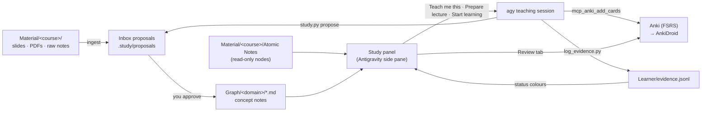

# study-engine

A deterministic study engine for university courses: it turns lecture material into a **concept graph**, shows it
in a side panel of the Antigravity app, hands focused lessons to an AI tutor (`agy`), and keeps spaced repetition in
**Anki**.

**Models only fill small, schema-checked forms; code decides everything else** — what is the same concept, which
link survives, the study order, verdicts, Anki ratings, and what enters the graph (only what you approve).

---

## Contents

- [What it does](#what-it-does)
- [How the pieces fit](#how-the-pieces-fit)
- [Install](#install)
- [Configuration](#configuration)
- [The Study panel](#the-study-panel)
- [Command line](#command-line)
- [Material → concept graph (ingest)](#material--concept-graph-ingest)
- [Teaching sessions: levels, lectures, capture](#teaching-sessions-levels-lectures-capture)
- [Anki review loop](#anki-review-loop)
- [Project layout](#project-layout)
- [Tests](#tests)
- [Status](#status)
- [License](#license)

---

## What it does

| | |
|---|---|
| **Concept graph** | Slides, PDFs and notes become concepts (definition + propositions) linked by *requires*, *contrasts with*, *analogue of*. Identity and link direction come from a cloud model; code applies vetoes (loops, lecture order, topic order) and drops shortcut links. |
| **Knowledge view** | All courses as concept **clusters** (macro-nodes) with directed arrows; open a cluster into its concepts; reasoning chains drawn as *A ∧ B ⟹ C*; layered or force layout with collision; drag clusters; click any link to see what it connects. |
| **Self-rated levels** | Pick a concept, a cluster or a course and rate yourself 1–5. The level chooses the session mode: 1 teach from scratch · 2 probe the gaps · 3 evaluation · 4 exam · 5 a CV-worthy project. |
| **Lectures** | A whole cluster as one lecture plan: prerequisites borrowed from other clusters, then every concept foundations-first. |
| **Capture** | Concepts taught in a session come back as one Inbox proposal per session (`study.py propose`); easy flashcards go to Anki as they are taught. |
| **Anki review** | Answer in your own words; a checklist + quote-verified grading decides the verdict and the 1–4 rating; misses create remedial cards due today. |

## How the pieces fit



The engine works on one workspace folder (here called `Magistrale/`, also opened as the Obsidian vault):

```text
Magistrale/
├── Material/<course>/        lectures, slides, labs; Raw Notes/, Atomic Notes/ (read-only graph nodes), Full Notes/
├── Graph/<domain>/<slug>.md  concept notes written by the engine (one fixed, validated format: engine/notes.py)
├── Learner/                  plans, session logs, evidence.jsonl — facts about the learner, never mixed into Graph/
├── .study/proposals/         Inbox proposals, shared between PCs through the synced folder
└── Agents/                   agy rules, skills, hooks and the deployed copy of this engine
```

The agy skills that teach (learning-harness, probe, teach, practice, project, anki-bridge…) live in the workspace's
`Agents/` folder, not in this repository; this repo is the engine and the panel they talk to.

## Install

Requirements: **Python 3.11+** (Windows is the tested platform), `pip install -r requirements.txt` (numpy, pypdf).

| Optional component | Used for |
|---|---|
| [Ollama](https://ollama.com) with `qwen3-embedding:8b` and `qwen3.5:9b` | embeddings and the local "is this already in the note?" judge during ingest |
| `agy` (Antigravity CLI) | the cloud jobs (extract, group, relate, grading) and the teaching sessions |
| Desktop Anki + [AnkiConnect](https://ankiweb.net/shared/info/2055492159) | review loop and card creation |
| Antigravity app | the Study side panel |

```bash
git clone https://github.com/ronMoisei/study-engine.git
cd study-engine
pip install -r requirements.txt
copy config.example.json config.json      # then set "magistrale" to your workspace folder
python -m unittest discover -s tests -t .  # offline: stub models, no Ollama/agy/Anki needed
```

### The side panel on every PC

```bash
python study.py deploy        # runtime copy -> <workspace>/Agents/study-engine (synced) + this PC's launcher plugin
```

On each other PC, once, from the synced copy:

```bash
python "<workspace>\Agents\study-engine\study.py" install-sidecar
pip install numpy pypdf
```

The Antigravity app only loads side panels from plugins in the global `~/.gemini/config/plugins/` folder, so each PC
gets a tiny launcher plugin `study` that starts `study.py serve --sidecar` from the synced copy. Don't use the panel
on two PCs at the same moment.

### Keeping devices in sync

Everything inside the workspace folder syncs through Google Drive by itself — material, `Graph/`, `Learner/`,
proposals, shared settings, the agy skills and the deployed engine — and the panel re-reads those files on every
request. What lives on each PC is checked and **repaired automatically every time the panel's engine starts**
(`engine/devicesync.py`); the ✓ chip in the panel's tab bar shows the result (click to re-check):

| Per PC | Rule |
|---|---|
| launcher plugin | rewritten if it doesn't start the synced engine with this PC's Python |
| agy MCP `anki` | (re)registered if missing or pointing at a path that doesn't exist on this PC |
| agy MCP `obsidian` | registered if missing, with the vault's Local REST API key (never printed) |
| python packages | numpy, pypdf reported if missing |
| running engine | a newer deploy from another PC is detected within ~20 s; the engine exits and the app restarts it on the new code; the panel reloads itself |
| dev clone | `python study.py sync --pull` fast-forwards a git checkout from GitHub (only when the tree is clean) |

```bash
python study.py sync           # the same check by hand, with a report
```

## Configuration

`config.json` next to `study.py` overrides the defaults in `engine/config.py` for **this PC** (unknown keys are an
error). Settings that must be the same everywhere go in the synced `<workspace>/.study/settings.json`
(allowed keys: `agy_project`, `teach_model`, `models`, `dry_run`):

```json
{"agy_project": "<id of the Antigravity project for panel conversations>"}
```

`agy_project` makes every conversation the panel starts (Teach me this, Prepare lecture, Start learning) open in
that project. The panel passes it the same way the app's own sidecar SDK does: as `ANTIGRAVITY_PROJECT_ID` for the
`agentapi new-conversation` call. It must be a project the app knows **on this PC**: a cloud-only project (cloud
icon in the app) is answered with "project not found", and the panel then falls back to its own project and says so.
(`agy --remote-agent` could reach a cloud project, but it does not support non-interactive starts yet.)

| Key | Default | Meaning |
|---|---|---|
| `magistrale` | auto-detected for a deployed copy | the workspace folder |
| `provider` | `agy` | `agy` · `stub` (offline tests) |
| `models` | see below | job → `provider:model` |
| `embed_model`, `ollama_url` | `qwen3-embedding:8b`, `http://127.0.0.1:11434` | local embeddings |
| `sim_floor`, `top_k`, `link_k` | 0.45, 5, 8 | candidate matching (from `bench/embed_pairs.py`) |
| `passage_chars_cloud` | 6000 | passage size for cloud extraction (agy adds ~10–13k tokens per call, so fewer, larger calls) |
| `anki_url`, `note_type`, `front_field`, `back_field` | AnkiConnect, `Basilare`, `Fronte`, `Retro` | review loop |
| `teach_model` | `flash` | model for a new conversation started from the panel |
| `dry_run` | false | never rate or add cards in Anki |

Model assignment (measured choices):

| Job | Default | Why |
|---|---|---|
| extract | `agy:gemini-3.8-flash-low` | local models split procedures into fragments; cached, paid once per file |
| group | `agy:gemini-3.8-flash-low` | claims → concepts + topics, one call per file, cached |
| relate | `agy:gemini-3.8-flash-low` | identity + prerequisite direction, 60 pairs per call; the local judge merged general concepts into specific ones |
| judge | `ollama:qwen3.5:9b` | only "is this proposition already in the note?"; 24/24 on `bench/judge_pairs.py` |
| checklist, grade, remedial | agy flash | review loop |

## The Study panel

Three tabs, plain JavaScript (`sidecar_ui/`), math rendered by vendored KaTeX 0.16.11.

**Graph**
- *A course*: the course's atomic notes plus every approved concept learned in that course — from its material or
  from a teaching session about it (the note's `course` field, or the course folder its source lies in). A course
  without atomic notes gets its graph as soon as it has one concept. The prerequisite DAG is laid out deterministically (`engine/layout.py`: level = longest path
  from a foundation, barycenter sweeps against crossings, foundations at the bottom), coloured by learner status.
- *All knowledge, by concept*: concept clusters as macro-nodes (`engine/clusters.py` — start from each note's topic,
  fold small topics into the cluster they share most links with). Arrows point from prerequisite to what builds on
  it; a concept with several premises gets a junction (*A ∧ B ⟹ C*).
  - click a cluster to open it; **✕ close**, or double-click empty space, to close it;
  - click an open cluster's **name** to prepare a lecture on it; drag a cluster (or its name) to move it — what it
    touches is pushed aside;
  - click a link: both ends stay lit and a card lists what it connects (for cluster arrows, the concept pairs behind it);
  - ⚙ settings: level of detail, layered or force layout (repulsion, link length, gravity, direction pull, spacing),
    colour by cluster / status / course, palette, glow, sizes, link opacity.
- Click a concept: definition, propositions, requires / needed by, study path, *Open in Obsidian*, and **Teach me
  this** with a 1–5 level and an optional goal.

**Inbox**
- *What do you want to learn?* — a file, folder, course or topic in words, a goal ("theory only, no code"), and
  your level → **Start learning** sends a deterministic session brief to agy.
- *Add material to the graph* — analyse a file, a folder or a whole course (≤ 25 files per run; domain defaults to
  the course name).
- *Proposals* — every concept and every link has its own checkbox; conflicts start unticked.

**Review** — the Anki loop below.

Security: the engine binds to `127.0.0.1` only, sends no CORS headers, and every API call must carry the token the
app passes to the sidecar; only the static UI files are served without it.

## Command line

```bash
python study.py serve [--sidecar]              # the engine (the app starts it with --sidecar)
python study.py deploy                         # copy to the workspace + install this PC's launcher
python study.py install-sidecar                # launcher only (other PCs)

python study.py ingest <file> --domain D       # material -> proposal (nothing written yet)
python study.py proposals | show <id>
python study.py approve <id> [--accept 0,2] [--reject 3]
python study.py plan <id>                      # study plan note: dependency order + defined-before-use check
python study.py propose <concepts.json>        # concepts taught in a session -> one Inbox proposal per session
python study.py sync [--pull]                  # check / repair this PC; --pull fast-forwards a git clone

python study.py review [--deck D] [--limit N]  # terminal review
python study.py decks
python study.py calls [--last N]               # every model call: job, model, ok, tokens, duration
```

Flags everywhere: `--stub` (offline stand-in models) · `--dry-run` (never rate or add in Anki).

## Material → concept graph (ingest)

| Step | Who | What |
|---|---|---|
| parse | code | file → passages; each PDF page / text paragraph keeps its own anchor |
| extract | model, cached per passage | claims, each with a verbatim quote |
| verify | code | a claim whose quote is not in the passage is dropped |
| group | model, one call per file, cached | claims → concepts (title, definition, propositions, topic) |
| pairs | local embeddings | each concept + its nearest notes above `sim_floor` |
| decide | model, one call per 60 pairs | same / A requires B / B requires A / contrasts / analogue / none |
| resolve | code | "same" → extends or is covered by an existing note, or merges into an earlier concept |
| veto | code | loops; a prerequisite appearing later in the same course or file; a later topic; a definition requiring an application → *conflict* |
| shortcuts | code | A→C dropped when A→…→C exists |
| approve | you | Inbox: concepts and links individually |
| write | code | `engine/notes.py` renders the one concept format and validates it before every write |

Links are stored in the **new** note (`Requires`, or `Prerequisite of` for "that note requires this one"), so course
notes are never edited. Topic order per domain lives in `Graph/<domain>/_topics.md` and is used as a veto.
Model output with LaTeX is repaired deterministically (escapes eaten by JSON, doubled backslashes inside math).

Why vetoes rather than free signals for direction (measured on 196 course notes): "B's text mentions A" points against
existing links as often as along them; lecture order never contradicted an existing link (157 checked).

## Teaching sessions: levels, lectures, capture

Every message the panel sends to agy is **built by code from the graph and the evidence log** — no model writes it:
the topic (a concept, a cluster, or material), your level and goal, the prerequisite path with your status per step,
and the rules of the session (open questions only, free-form replies, capture after each unit).

| Level | You mean | Session |
|---|---|---|
| 1 | I don't know anything | introduction, then you derive the concepts through guided exercises and proofs |
| 2 | I know parts of it | probe for the gaps, then teach only those |
| 3 | I know it | hard single-topic problems |
| 4 | I think I know everything | exam questions, multi-step and multi-topic |
| 5 | I master it | three real projects worth a CV line; build one together |

**Capture.** After each unit the tutor appends what it taught to `Learner/sessions/<session>_concepts.json` and runs:

```bash
python study.py propose Learner/sessions/2026-11-16_dsml_labs_concepts.json
```

```json
{"session": "2026-11-16_dsml_labs", "course": "01VSCWS - Data science and machine learning",
 "source": "Learner/sessions/2026-11-16_dsml_labs.md",
 "concepts": [{"title": "Gini impurity", "kind": "definition", "topic": "decision-trees",
               "definition": "$G(P) = 1 - \\sum_c p_c^2$ …", "propositions": ["…"],
               "requires": [], "related": [["contrasts_with", "Shannon entropy of a node"]]}]}
```

No model call: a title or alias matching an existing note extends it (only new propositions) or is already covered;
`requires` must name an existing note or another concept of the file, anything else is reported and dropped. The same
session always updates the same proposal, keeping the decisions you already took in the Inbox. The printed slugs
become the flashcards' `lh::<slug>` tags.

## Anki review loop

1. Due cards come from AnkiConnect — **fronts only**.
2. You answer in your own words (type or dictate); confidence is optional.
3. **checklist** (once per card, cached): 1–5 checkpoints from the card's back.
4. **grade**: met / not met per checkpoint, each "met" backed by a verbatim quote from your answer; code rejects
   any quote that isn't in your answer, then `grading.decide()` computes the verdict and the 1–4 ease.
5. Evidence goes to `Learner/evidence.jsonl` **before** the card is rated.
6. On a miss: 1–2 remedial cards due today, tagged `remedial gap::<node>`.

## Project layout

```text
study.py                 CLI: serve, deploy, ingest, proposals, approve, plan, propose, review, calls
engine/
  config.py              settings (config.json overrides)
  material.py            PDF / text parsing into anchored passages
  llm.py                 agy (stdin stream-json), Ollama and stub providers, routing, LaTeX repair
  embed.py, store.py     local embeddings, SQLite cache and call log (%LOCALAPPDATA%\study-engine)
  ingest.py              the ingest pipeline, proposals, approval (the only writer of concept notes), plans
  session.py             concepts from a teaching session -> Inbox proposal
  notes.py               the concept note format: render, parse, validate
  graph.py, terms.py     the index over Graph/ + atomic notes; loops, order, study order; term index
  topics.py, clusters.py topic order per domain; concept clusters for the knowledge view
  layout.py              deterministic layered layout, cluster packing
  graphview.py, learn.py what the panel shows; session briefs for levels, lectures, Start learning
  learner.py, evidence.py learner status from the evidence log
  grading.py, review.py, anki.py   the review loop
  server.py, sidecar.py  local HTTP API; Antigravity sidecar manifest and agentapi
sidecar_ui/              the panel: index.html, app.js, knowledge.js, app.css, vendor/katex
obsidian-plugin/         the earlier Obsidian panel (superseded by sidecar_ui/)
bench/                   pair sets used to choose the embedding threshold and the judge model
tests/                   offline tests (stub models, temporary workspace)
```

## Tests

```bash
python -m unittest discover -s tests -t .
```

Everything runs offline: stub models, a fake embedder, a temporary workspace, no Ollama, agy or Anki.

## Status

Built: ingest → proposals → graph, the Study panel (course graph, knowledge view, Inbox, Review), levels 1–5,
cluster lectures, session capture, the Anki review loop.

Next (design stage): evaluation from AnkiDroid cards linked to knowledge gaps; a research phase that finds new
sources; lateral links across courses (and novel knowledge from projects); a router that gives easy jobs to local
models and scripts and hard ones to cloud models; courses without video lectures.

## License

MIT — see [LICENSE](LICENSE). Vendored [KaTeX](https://katex.org) is MIT licensed
([sidecar_ui/vendor/katex/LICENSE](sidecar_ui/vendor/katex/LICENSE)).
